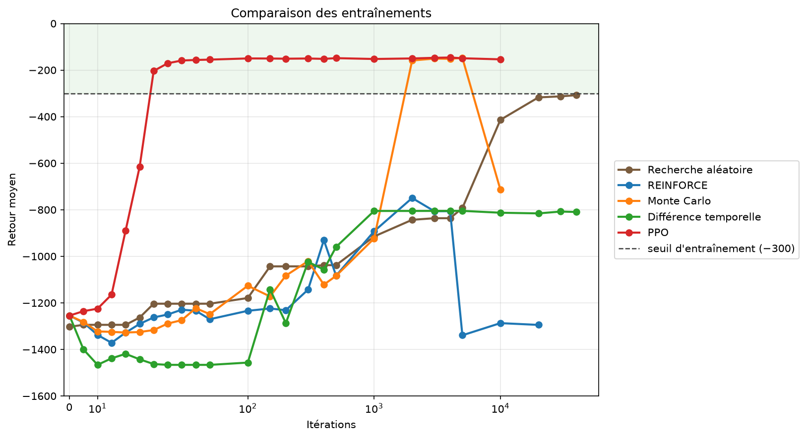

# Pendule inversé par apprentissage par renforcement — du gradient au PPO

Comparaison des entrainements entre différente méthodes d'apprentisssage par renforcement. On compare une recherche aléatoire, la méthode REINFORCE, la méthode REINFORCE + Montecarlo, la méthode REINFORCE + Différence temporelle et enfin la PPO. 

Voici le retour moyen au fil des itérations. Plus le nombre est proche de 0, mieux le pendule tient la verticale. Au-dessus de −300, il est tenu pour entraîné. On voit que la méthode **PPO domine** largement avec un **apprentissage fiable et rapide**.

Objectif : apprendre à un réseau de neurones à redresser puis maintenir un
pendule inversé à la verticale, en construisant chaque brique soi-même :
descente de gradient et rétropropagation codées à la main, passage à PyTorch,
puis gradient de politique (REINFORCE), acteur-critique et PPO.

Chaque script est autonome et commenté (en français).

## Le pendule — `pendule/`

Environnement simulé (`pendule_env.py`) : couple borné, 200 pas par épisode,
récompense = −(écart angulaire² + 0,1·vitesse² + 0,001·couple²).

| Script | Contenu |
|---|---|
| `ch1_retour.py` | Épisodes, retour, retour actualisé (γ) |
| `ch2_politique.py` | Politique gaussienne, log-probabilité et son gradient |
| `ch3_recherche_aleatoire.py` | Optimisation sans gradient (recherche aléatoire) |
| `ch4_reinforce.py` | REINFORCE : gradient de politique |
| `ch5_6_baseline_critique.py` | Baseline, avantage, critique V(s) (Monte-Carlo et TD) ; mesure de la variance des estimateurs de gradient |
| `ppo.py` | PPO : acteur-critique, GAE, ratio clippé, 16 environnements en parallèle |
| `simulation_pendule.py` | Visualisation Tkinter d'une politique entraînée |

## Les bases — `bases/`

### `01_numpy/` : tout à la main

Forward, fonction de perte, gradients et mise à jour codés en NumPy.

| Script | Contenu |
|---|---|
| `gradient_descent.py` | Descente de gradient sur (w − 3)² |
| `neuron_without_activation.py` | Régression linéaire (MSE) sur données bruitées |
| `neuron_without_activation_2.py` | Régression polynomiale, gradients dérivés à la main |
| `and.py` | Porte ET : régression logistique, entropie croisée binaire |
| `tanh.py` | Régression de tanh(2x) par un neurone caché, rétropropagation manuelle |
| `xor.py` | XOR : réseau 2 → 4 → 1, rétropropagation matricielle |
| `xor2.py` | Comparaison sigmoïde / tanh / ReLU, diagnostic des neurones ReLU morts |

### `02_pytorch/` : PyTorch et apprentissage supervisé

| Script | Contenu | Résultat |
|---|---|---|
| `pytorch_xor.py` | XOR avec `nn.Sequential`, `BCELoss`, SGD | |
| `manual_versus_pytorch.py` | Gradients calculés à la main comparés à l'autograd | identiques (`allclose`) |
| `neuron_layer.py` | Taux de réussite selon la largeur de la couche cachée (20 graines) | 1 neurone : 0/20, 4 neurones : 19/20 |
| `train_and_test.py` | Biais / variance : erreur train vs test selon la complexité du modèle | mise en évidence du surapprentissage |
| `digit_analysis.py` | Classification de chiffres manuscrits (MLP 64 → 32 → 10, mini-batchs) | **96,9 %** de précision en test |
| `network_type.py` | Spirales : large et peu profond vs étroit et profond, à nombre de paramètres égal | 98,5 à 100 % en test |
