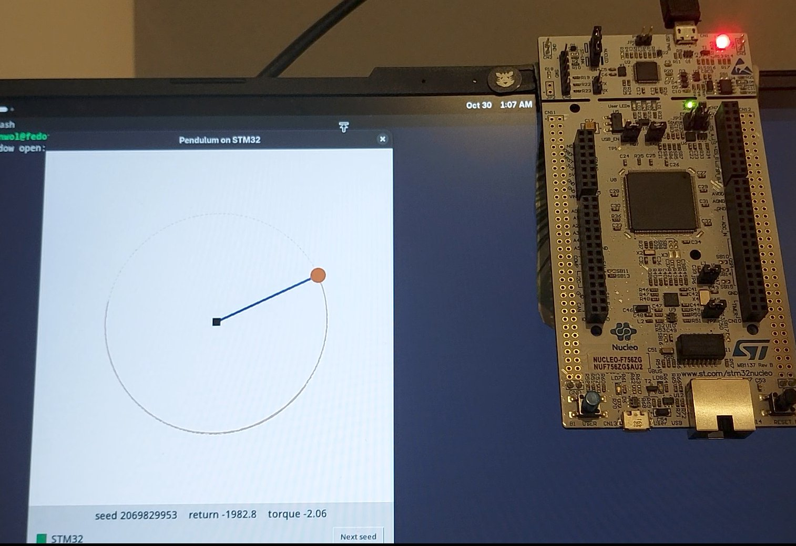
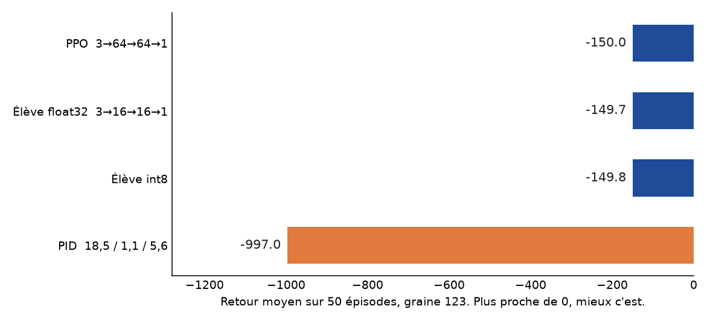

# Pendule inversé, de l'apprentissage au STM32

Un réseau apprend à redresser un pendule, puis un élève assez petit pour tenir sur une Nucleo-F756ZG fait le même travail. Le PC simule la physique. La carte, à 20 Hz, renvoie le couple.




Vidéo : ++[https://youtu.be/hBLaUM1HigA?si=2EWYkwLywpu2pqIw](https://youtu.be/hBLaUM1HigA?si=2EWYkwLywpu2pqIw)++

## Résultats

Retour moyen sur 50 épisodes, graine 123, sans frottement. Un épisode dure 200 pas de 50 ms. La récompense d'un pas est −(angle² + 0,1·vitesse² + 0,001·couple²). Plus le total est proche de 0, mieux le pendule tient la verticale. Au-dessus de −300, il est tenu pour entraîné.



| Politique | Taille | Retour |
|---|---|---:|
| PPO, référence | 4 481 paramètres, 3→64→64→1 | −150,0 |
| Élève float32 | 353 paramètres, 3→16→16→1 | −149,7 |
| Élève int8, mesuré sur PC | mêmes couches, entiers | −149,8 |
| PID, Kp 18,5, Ki 1,1, Kd 5,6 | loi linéaire, couple borné à ±2 | −997 |

L'élève reproduit la PPO. L'int8, sur PC, ne la dégrade presque pas. Le PID tient un petit écart en haut et ne rattrape pas un départ trop bas : le couple maximum ne suffit plus. Le firmware flashé reste en float32.

## Sur la carte

Nucleo-F756ZG, X-CUBE-AI 10.2.1, cible `stm32f7`, sans compression. Le graphe va de l'observation brute `(cos θ, sin θ, θ̇)` au couple, avant l'écrêtage à ±2.

| | Occupé | Carte | Part |
|---|---:|---:|---:|
| Flash | 11,5 Ko | 1 Mo | 1,1 % |
| RAM | 1,9 Ko | 320 Ko | 0,6 % |

Le pas de contrôle dure 50 ms. La gigue est l'écart entre le plus rapide et le plus lent, sur 200 pas.

| | Moyenne | Gigue |
|---|---:|---:|
| Liaison PC ↔ carte, USB compris | 2,90 ms | 1,25 ms |
| Calcul du réseau sur la carte | 48 µs | 2 µs |

Quatre observations fixes donnent le même couple sur la carte et dans PyTorch, à l'affichage près (écart sous un demi-millionième). Le retour des 50 épisodes n'a pas été rejoué à travers l'UART. Le bruit sur les mesures et le retard de communication ne sont pas mesurés.

## Branchement


Le PC envoie trois float32. La carte répond par un float32. L'écrêtage à ±2 et l'intégration du pendule restent sur le PC.

## Lancer

Les scripts Python d'`embedded/` se lancent depuis ce dossier.

```bash
cd embedded
python ppo.py
python distill.py
python quantize.py
python export_onnx.py
python simulation.py --student
python hil.py
```

`hil.py` parle à la carte sur `/dev/ttyACM0`. Le projet CubeIDE est `firmware/`. Il faut le flasher avant la boucle.

Le réglage du PID est à part :

```bash
python pid/tune.py
```

## Dossiers

| Dossier | Rôle |
|---|---|
| `bases/` | Gradient, neurone, XOR, puis PyTorch |
| `pendule/` | Du retour d'épisode jusqu'à la PPO, en français |
| `embedded/` | Contrat à 20 Hz, distillation, int8, ONNX, boucle UART |
| `firmware/` | Projet Nucleo-F756ZG et réseau X-CUBE-AI |
| `pid/` | Fenêtre pour régler un PID et le comparer à l'élève |
| `docs/` | Graphique, et la photo de la démo |

`pendule/` ne dépend pas d'`embedded/`. Les noms de fichiers d'`embedded/` et du firmware utile sont en anglais.

## Le chemin jusqu'à la PPO

`pendule/` compare une recherche aléatoire, REINFORCE, REINFORCE avec une baseline Monte-Carlo, REINFORCE avec une différence temporelle, et la PPO.


| Script | Contenu |
|---|---|
| `ch1_retour.py` | Épisode, retour, retour actualisé |
| `ch2_politique.py` | Politique gaussienne et gradient de la log-probabilité |
| `ch3_recherche_aleatoire.py` | Recherche sans gradient |
| `ch4_reinforce.py` | REINFORCE |
| `ch5_6_baseline_critique.py` | Baseline, avantage, critique Monte-Carlo et TD |
| `ppo.py` | PPO, acteur-critique, GAE, 16 environnements |
| `simulation_pendule.py` | Visualisation |

## Les bases

`bases/01_numpy/` code la descente de gradient, un neurone, les portes ET et XOR, et la rétropropagation à la main.

`bases/02_pytorch/` reprend ces idées avec PyTorch. Les gradients manuels collent à l'autograd. Un perceptron sur des chiffres manuscrits atteint 96,9 % en test.
